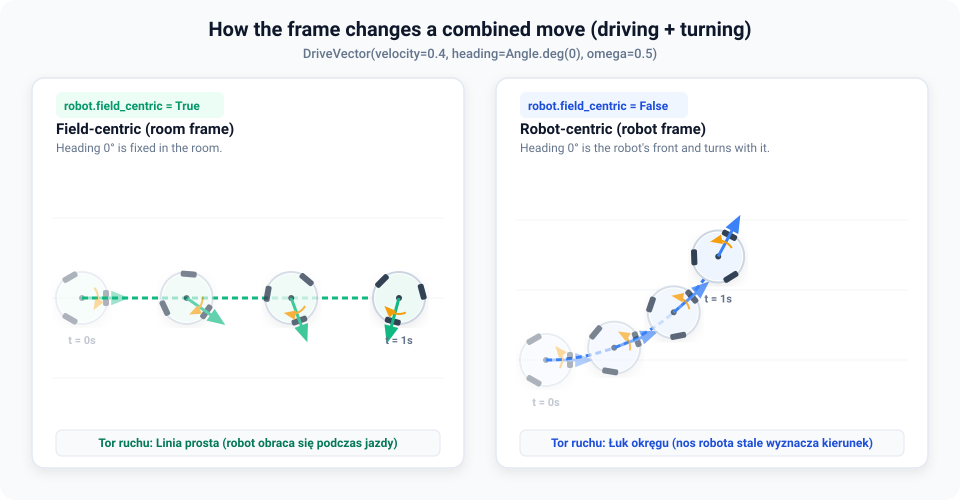

# Getting started

`omni_drive` is the Python library for controlling the OmniDrive robot and reading its sensors
from a Jupyter notebook. This page walks through everything you need for the lab, with a short
example for each part. Each section links to the page that explains the topic in detail.

The examples assume the imports from the lab notebook are already in place. To open the
notebook on the robot, see [On the robot](getting-started/robot.md).

## Connect to the robot

```python
robot = OmniDrive()
robot.print_status()
```

`OmniDrive()` always returns the same connection, so you can call it in several cells.
`print_status()` shows the battery, the pose, the wheel speeds and the distance sensors. If it
prints `[Status] No telemetry received.`, wait a few seconds and run it again.

## Two ways to drive

`omni_drive` gives you two ways to control the robot:

| Mode | How it works | Use it for |
| --- | --- | --- |
| **Reactive** (small steps) | A `Clock` ticks at a fixed rate. On every tick you read the sensors and set a new command. | Reacting to sensors live, changing speed smoothly, motion profiles |
| **Declarative** (big steps) | `drive_for` and `pause_for` run one planned move at a time and wait until it ends. | Fixed sequences of moves |

Both are explained in [Driving](guides/driving.md).

### Reactive mode

A loop driven by a `Clock` runs at a fixed rate and does the waiting for you:

```python
async with robot:
    async for t in Clock(duration=Time.s(2)):
        # Drive forward at 20 % of full speed:
        robot.set_vector(DriveVector(velocity=0.2, heading=Angle.deg(0)))
```

- `Clock(duration=Time.s(2))` ticks every 100 ms for 2 seconds. `t` is the time since the
  start, as a `Time`; set a different rate with `period=Time.ms(...)`.
- `async with robot:` stops the robot when the block ends, also when the cell fails or you
  press the stop button. Always drive inside it. See [Stopping safely](guides/safety.md).
- `velocity` and `omega` are fractions of full speed, from `-1.0` to `1.0`, not meters or
  radians per second. `heading` is the direction of travel: `0°` forward, `90°` left.

Because the loop knows the time, the command can change with it, for example a speed that
slowly builds up:

```python
async with robot:
    async for t in Clock(duration=Time.s(2)):
        v = 0.1 * t.seconds  # from 0 to 0.2 over 2 seconds
        robot.set_vector(DriveVector(velocity=v, heading=Angle.deg(0)))
```

A negative `velocity` drives in the opposite direction.

#### Read the sensors in the loop

Read the robot's properties inside the loop and react straight away:

```python
async with robot:
    async for t in Clock(duration=Time.s(5)):
        dist_front = robot.us_front.distance

        # Stop when an obstacle is closer than 20 cm:
        if dist_front < Distance.cm(20):
            print("Obstacle detected, stopping")
            break

        robot.set_vector(DriveVector(velocity=0.2, heading=Angle.deg(0)))
```

#### Share the clock

One `Clock` can pace several things at once, for example the control loop and a
`SensorRecorder`. Every recorded sample then lines up with a loop step:

```python
clock = Clock(duration=Time.s(3))

# Data sources sampled on every tick of the clock:
rec = SensorRecorder(
    clock,
    front=lambda: robot.us_front.distance.meters,
    left=lambda: robot.us_left.distance.meters,
)

# Control loop and live plot together:
async with LivePlot(rec), robot:
    async for t in clock:
        robot.set_vector(DriveVector(velocity=0.2, heading=Angle.deg(0)))
```

Each channel is a function without arguments that returns something `float()` accepts. Return
`.meters`, not a `Distance`: a `Distance` makes the recording stop without an error message.
Infinite readings (for example `Distance.inf` from a sensor without an echo) are stored as
`NaN`, so they show up as gaps.

After the run, `rec.data` holds every sample as lists, with the time in `rec.data["t"]`. Turn
it into a table for analysis:

```python
df = pd.DataFrame(rec.data)
df.head()
```

See [Visualizing](guides/visualizing.md) for more channels, plot styles and 2D trajectories
(`PoseRecorder`).

### Declarative mode

Declarative mode is short and suits planned manoeuvres. It is blocking: each call waits until
its move has finished before the next line runs.

```python
async with robot:
    # 1. Drive forward for 2 seconds:
    await robot.drive_for(Time.s(2), DriveVector(velocity=0.2, heading=Angle.deg(0)))

    # 2. Stand still for 1 second:
    await robot.pause_for(Time.s(1))

    # 3. Turn on the spot for 2 seconds (omega = turn rate):
    await robot.drive_for(Time.s(2), DriveVector(velocity=0.0, heading=Angle.deg(0), omega=0.5))
```

`drive_for` takes the duration first and the vector second, and stops the robot when the time
is up.

## Robot pose and resetting odometry

The robot continuously computes its pose from the wheel encoders (`robot.pose`). You can reset
it at any time; the current position then becomes the origin:

```python
pose = robot.pose
print(f"{pose.x.meters:.3f} m, {pose.y.meters:.3f} m, {pose.yaw.degrees:.1f}°")  # e.g. 0.450 m, 0.120 m, 35.0°

robot.reset_pose()

print(robot.pose)  # Pose(x=0.000m, y=0.000m, yaw=0.0°), or yaw=360.0° for a tiny negative yaw
```

- `pose.x` and `pose.y` are `Distance` values and `pose.yaw` is an `Angle`, so read them with
  `.meters` and `.degrees` or `.radians`.
- After a reset, x points forward, y to the left, and yaw grows counter-clockwise.
- Odometry drifts the longer you drive, because the wheels slip. See
  [Odometry and drift](concepts/odometry.md) and [Frames and units](concepts/frames.md).

## Units

`omni_drive` uses its own types for physical quantities, so units can't get mixed up:

| Type | Create | Read |
| --- | --- | --- |
| `Distance` | `Distance.m(0.25)`, `Distance.cm(25)`, `Distance.mm(250)` | `.meters`, `.as_cm`, `.as_mm` |
| `Angle` | `Angle.deg(90)`, `Angle.rad(1.57)` | `.degrees` (always 0–360), `.radians` |
| `Time` | `Time.s(1.5)`, `Time.ms(1500)` | `.seconds` |

```python
dist = Distance.cm(25)
print(f"Distance: {dist.meters} m = {dist.as_cm} cm = {dist.as_mm} mm")

ang = Angle.deg(90)
print(f"Angle: {ang.degrees:.1f}° = {ang.radians:.3f} rad")

t = Time.s(1.5)
print(f"Time: {t.seconds} s")
```

Values of the same type can be compared, for example `robot.ir_front.distance < Distance.cm(30)`.
Comparing a `Distance` with a plain number raises an error. All types are described in
[`omni_drive.models`](reference/models.md).

## Distance sensors (ToF and ultrasonic)

The robot has two sets of distance sensors around its body:

| Direction | Time-of-Flight (laser) | Ultrasonic |
| --- | --- | --- |
| left (+90°) | `robot.ir_left` | `robot.us_left` |
| front (0°) | `robot.ir_front` | `robot.us_front` |
| right (−90°) | `robot.ir_right` | `robot.us_right` |

The `.distance` property of each sensor returns a `Distance`:

```python
print(f"Front: ToF = {robot.ir_front.distance.meters:.3f} m  |  US = {robot.us_front.distance.meters:.3f} m")
print(f"Left:  ToF = {robot.ir_left.distance.meters:.3f} m  |  US = {robot.us_left.distance.meters:.3f} m")
print(f"Right: ToF = {robot.ir_right.distance.meters:.3f} m  |  US = {robot.us_right.distance.meters:.3f} m")
```

- The `ir_*` sensors are VL53L1X Time-of-Flight sensors: they measure how long an infrared
  laser pulse takes to come back.
- When a sensor has no valid reading (no echo, out of range), `.distance` is `Distance.inf`.
- The firmware adds Gaussian noise to both kinds of sensor on purpose, so the lab's filtering
  tasks have something to filter.
- To wait until a reading meets a condition, use
  `await robot.us_front.wait_for(lambda d: d < Distance.cm(30))`.

See [Reading sensors](guides/sensors.md) for update rates, ranges and noise.

## LiDAR

The LiDAR provides averaged beams in the same three directions as the distance sensors:

```python
print(f"LiDAR left (+90°):  {robot.lidar.beam_left.meters:.3f} m")
print(f"LiDAR front (0°):   {robot.lidar.beam_front.meters:.3f} m")
print(f"LiDAR right (-90°): {robot.lidar.beam_right.meters:.3f} m")
```

- Each beam is an average over many neighbouring laser points, which removes most of the
  noise. That is why the lab uses the LiDAR as the reference for the other sensors.
- The beams return a `Distance`, or `Distance.inf` if there are not enough points in that
  direction.
- The beam directions are fixed in the room, like field-centric headings (see below). After
  the robot turns, `beam_front` still looks the way the robot faced at the last
  `reset_pose()`, while `ir_front` turns with the robot.

## Other features

Telemetry and diagnostics that you usually don't need for basic driving:

- `robot.power`: the power supply (`percentage`, `voltage`, `current`, `is_critical`).
- `robot.lidar`: the latest raw LiDAR scan. `robot.lidar.point_cloud` returns a NumPy array of
  shape `N × 2` with `[x, y]` points in meters, which the library also uses for SLAM
  ([Localization](guides/localization.md)).
- `robot.print_status()`: a full diagnostic summary of the robot.

```python
# Power supply:
print(f"Battery: {robot.power.percentage:.1f}% ({robot.power.voltage:.2f} V, {robot.power.current:.2f} A)")
if robot.power.is_critical:
    print("Warning: the battery is low, charge the robot")

# Raw LiDAR point cloud:
pts = robot.lidar.point_cloud
print(f"Points in the LiDAR scan: {len(pts)}")

# Full status report:
robot.print_status()
```

## Frame of reference (`robot.field_centric`)

When you set a `DriveVector`, its direction of travel (`heading`) can mean two different
things, in both driving modes:

- `robot.field_centric = True` (**field-centric, default**): the heading is measured in the
  room. `0°` is always the same direction in the room (the way the robot faced at the last
  `reset_pose()`, or when you connected if you never called it), even when the robot turns on
  the spot.
- `robot.field_centric = False` (**robot-centric**): the heading is measured from the robot.
  `0°` is always the direction the robot's front (`us_front`) is facing. When the robot turns,
  the directions turn with it.

You can switch the flag at any time.

**Room frame:**

```python
# Field-centric is on by default: headings are fixed in the room.
print(robot.field_centric)  # True

async with robot:
    # 1. Drive towards 0°:
    await robot.drive_for(Time.s(1), DriveVector(velocity=0.2, heading=Angle.deg(0)))
    # 2. Turn on the spot:
    await robot.drive_for(Time.s(1), DriveVector(velocity=0.0, heading=Angle.deg(0), omega=0.5))
    # 3. Drive towards 0° again, in the SAME direction as before, although the robot has turned:
    await robot.drive_for(Time.s(1), DriveVector(velocity=0.2, heading=Angle.deg(0)))
```

**Robot frame:**

```python
# Robot-centric: headings are measured from the robot's front.
robot.field_centric = False

async with robot:
    # 1. Drive towards 0° (forward):
    await robot.drive_for(Time.s(1), DriveVector(velocity=0.2, heading=Angle.deg(0)))
    # 2. Turn on the spot:
    await robot.drive_for(Time.s(1), DriveVector(velocity=0.0, heading=Angle.deg(0), omega=0.5))
    # 3. Drive towards 0° again, now in the robot's NEW forward direction:
    await robot.drive_for(Time.s(1), DriveVector(velocity=0.2, heading=Angle.deg(0)))

robot.field_centric = True  # back to the default
```

The setting stays until you change it, also in later cells, because `OmniDrive()` is always the
same object.

The setting matters most when the robot drives and turns at the same time. Run this once in
each mode:

```python
for field_centric in (True, False):
    robot.field_centric = field_centric
    async with robot:
        await robot.drive_for(Time.s(1), DriveVector(velocity=0.4, heading=Angle.deg(0), omega=0.5))
        await robot.pause_for(Time.s(2))

robot.field_centric = True  # back to the default
```



With `field_centric = True` the robot spins while it drives in a straight line. With
`field_centric = False` it drives a curve, because "forward" turns with the robot. See
[Driving](guides/driving.md) and [Frames and units](concepts/frames.md).

## Stop the robot

If the robot keeps moving after a cell, for example because you used `set_vector` outside
`async with robot:`, stop it with:

```python
robot.stop()
```

The robot also stops by itself if it receives no command for 300 ms, for example after a
kernel restart. See [Stopping safely](guides/safety.md).

## Where to go next

| Task | Page |
| --- | --- |
| Switch the robot on and open the lab notebook | [On the robot](getting-started/robot.md) |
| All the ways to command the wheels | [Driving](guides/driving.md) |
| What each sensor returns, how often and how noisy | [Reading sensors](guides/sensors.md) |
| Know where the robot is (LiDAR map + Kalman filter) | [Localization](guides/localization.md) |
| Record and plot what the robot sees | [Visualizing](guides/visualizing.md) |
| Which way x, y and yaw point | [Frames and units](concepts/frames.md) |
| How the Kalman filter works | [The Kalman filter](concepts/kalman.md) |
| Every class and function | [API reference](reference/omni_drive.md) |
